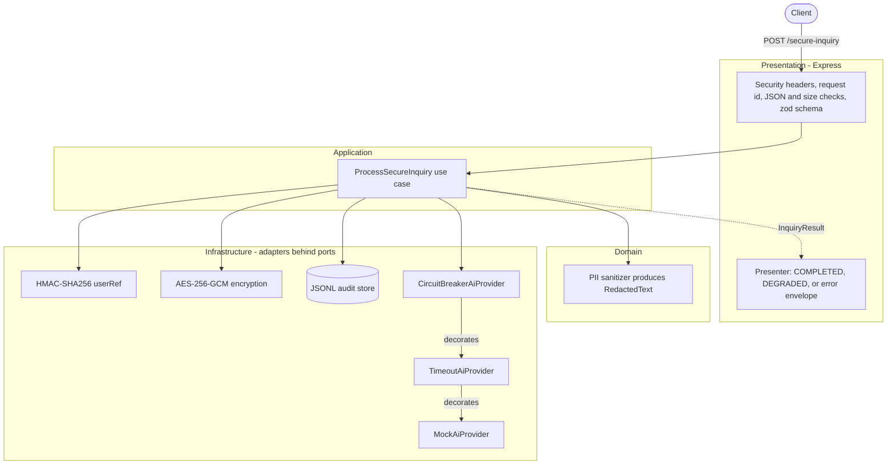

# Guardian Integration Gateway

A secure middleware between clients and an AI provider:

- **Redacts PII** (emails, credit cards, SSNs) before any text leaves the service.
- **Encrypts the original message** (AES-256-GCM) into an append-only audit trail, written *before* the provider is called.
- **Shields the provider** behind a timeout and a circuit breaker that answers "Service Busy" in milliseconds once the provider keeps failing.
- Node.js 24 + TypeScript, Express 5, zod, pino. The AI provider is a deterministic mock.

**Demo video:** [walkthrough on Loom](https://www.loom.com/share/d420f65af28a42b6aadbd50f88f8eae8)

## Contents

[Prerequisites](#prerequisites) · [Quick start](#quick-start) · [Configuration](#configuration) · [Commands](#commands) · [API](#api) · [Architecture](#architecture) · [Design patterns](#design-patterns) · [Security decisions](#security-decisions) · [Circuit breaker](#circuit-breaker) · [Development keys](#development-only-key-generation) · [Demo-video guide](#demo-video-guide) · [Known limitations](#known-limitations) · [Resolved review findings](#resolved-review-findings) · [Project layout](#project-layout) · [Further docs](#further-documentation)

## Prerequisites

| Tool | Version | Needed for |
|---|---|---|
| Node.js | ≥ 22.13 (developed and verified on 24.19) | local run, tests, key script |
| npm | bundled with Node (verified 11.x) | dependencies, scripts |
| Docker Engine + Compose v2 | verified on Docker 28.3 | container run |
| `curl` or PowerShell | any | trying the API |

## Quick start

### Local

```bash
npm ci
npm run setup:dev-env   # writes .env with every variable and two fresh dev keys (refuses to overwrite)
npm run dev             # http://localhost:3000, reloads on change
curl http://localhost:3000/health
```

Setup uses `npm run setup:dev-env`, or copy `.env.example` to `.env` and fill in the two keys ([how](#development-only-key-generation)).

### Docker Compose

```bash
npm run setup:dev-env        # Compose reads .env only to fill ${...} in docker-compose.yml
docker compose up --build -d
docker compose ps            # STATUS shows "(healthy)" after a few seconds
curl -i http://localhost:3000/health
docker compose down          # keeps the audit volume; add -v to delete it
```

Keys reach the container as runtime environment variables; they are never copied into the image. Compose stops with `required variable AUDIT_ENCRYPTION_KEY is missing a value` if the keys are not set.

## Configuration

Every variable is read once at startup and validated with zod. An invalid value stops the process with exit code 1 and a message that names the variable, never its value. Empty values count as unset. Numeric variables accept the digits 0-9 only: whitespace, signs, decimals, exponents, and hex are rejected.

| Variable | Default | Required | Meaning |
|---|---|---|---|
| `NODE_ENV` | `development` | no | `development`, `test`, or `production` (the image sets `production`) |
| `PORT` | `3000` | no | HTTP port, 1–65535 (Compose fixes it to 3000 inside the container) |
| `LOG_LEVEL` | `info` | no | `fatal`, `error`, `warn`, `info`, `debug`, `trace`, `silent` |
| `REQUEST_BODY_LIMIT_BYTES` | `16384` | no | Maximum request body size; larger bodies get 413 |
| `AUDIT_FILE_PATH` | `./data/audit.jsonl` | no | JSON Lines audit file (Compose: `/app/data/audit.jsonl` on a named volume) |
| `AUDIT_ENCRYPTION_KEY` | — | **yes** | Canonical base64 of exactly 32 random bytes; encrypts the original message |
| `AUDIT_ENCRYPTION_KEY_ID` | `v1` | no | Key label stored with each ciphertext for rotation; 1–64 of `A-Z a-z 0-9 . _ -` |
| `AUDIT_USER_REF_KEY` | — | **yes** | Second 32-byte base64 key for the `userId` pseudonym; must differ from the encryption key |
| `AI_PROVIDER_DELAY_MS` | `2000` | no | Simulated provider latency (integer ≥ 0) |
| `AI_PROVIDER_TIMEOUT_MS` | `5000` | no | Slower replies fail with `TIMEOUT` and count as breaker failures |
| `AI_PROVIDER_FAILURES` | `never` | no | Failure injection: `never`, `always`, or `first:<n>` (first n calls fail, then recover) |
| `CIRCUIT_BREAKER_FAILURE_THRESHOLD` | `3` | no | Consecutive failures that open the circuit (≥ 1) |
| `CIRCUIT_BREAKER_COOLDOWN_MS` | `30000` | no | Time OPEN before one recovery probe (≥ 1) |
| `HOST_PORT` | `3000` | no | Compose only: host port mapped to the container's 3000 |

## Commands

| Command | What it does |
|---|---|
| `npm run dev` | Run from source with reload (`tsx watch`), loading `.env` if present |
| `npm run build` | Clean `dist/` and compile with `tsconfig.build.json` |
| `npm start` | Run the compiled service (`node dist/main.js`); export the variables first |
| `npm test` | Run the Vitest suite once (`npm run test:watch` to watch) |
| `npx vitest run test/e2e --reporter=verbose` | Only the end-to-end circuit breaker scenario (`test/e2e/`, real 2 s provider delay, about 8 s), printing its measured latencies |
| `npm run lint` | ESLint, type-aware, including the layer-boundary rules |
| `npm run typecheck` | `tsc --noEmit` over `src/` and `test/` |
| `npm run check` | typecheck + lint + test (the CI gate) |
| `npm run setup:dev-env [-- <path>]` | Create a development env file (default `.env`) with fresh keys |
| `docker compose up --build -d` | Build the image and start the service in the background |
| `docker compose logs -f gateway` | Follow the JSON logs |
| `docker compose down` / `down -v` | Stop and remove the container / also delete the audit volume |

## API

### `GET /health`

`200 {"status":"ok"}`. Used by the container `HEALTHCHECK`.

### `POST /secure-inquiry`

```bash
curl -s http://localhost:3000/secure-inquiry -H 'Content-Type: application/json' \
  -d '{"userId":"demo-user","message":"Email jane.doe@example.com, card 4111 1111 1111 1111, SSN 123-45-6789. Can you help?"}'
```

| Rule | Limit |
|---|---|
| `Content-Type` | `application/json`, with no charset or `charset=utf-8` only; anything else → 415 |
| Body size | `REQUEST_BODY_LIMIT_BYTES` (16384) → 413 |
| Fields | exactly `userId` and `message`; unknown fields → 400 |
| `userId` | string, trimmed, 1–128 characters |
| `message` | string, 1–5000 characters, not blank |

**Success** (measured, ~2 s with the default delay):

```json
{
  "requestId": "…",
  "inquiryId": "da8a6076-9e71-4abb-a132-0af120963777",
  "sanitizedMessage": "Email <REDACTED: EMAIL>, card <REDACTED: CREDIT_CARD>, SSN <REDACTED: SSN>. Can you help?",
  "reply": "Generated Answer: Email <REDACTED: EMAIL>, card <REDACTED: CREDIT_CARD>, SSN <REDACTED: SSN>. Can you help?",
  "status": "COMPLETED",
  "source": "AI_PROVIDER"
}
```

**Fallback** (same schema; `reason` is `PROVIDER_ERROR`, `TIMEOUT`, or `CIRCUIT_OPEN`):

```json
{
  "requestId": "…",
  "inquiryId": "02fdb947-5e05-4aef-8911-23dfb999cc07",
  "sanitizedMessage": "Email <REDACTED: EMAIL>, card <REDACTED: CREDIT_CARD>, SSN <REDACTED: SSN>. Can you help?",
  "reply": "Service Busy",
  "status": "DEGRADED",
  "source": "FALLBACK",
  "reason": "CIRCUIT_OPEN"
}
```

**Error** (one envelope; `details` only for validation and names fields, never values):

```json
{
  "requestId": "40a55120-b82d-468d-8686-ecd6bad48fff",
  "error": {
    "code": "VALIDATION_ERROR",
    "message": "Invalid request body",
    "details": [{ "path": "message", "issue": "Message must not be blank" }]
  }
}
```

`requestId` equals the `X-Request-Id` response header; a well-formed incoming one (`[A-Za-z0-9._-]{1,128}`) is echoed. `inquiryId` is the audit record id. The response never contains the original message, the raw `userId`, `userRef`, ciphertext, keys, or stack traces.

| Status | `code` | When |
|---|---|---|
| 200 | — | `COMPLETED`, or a `DEGRADED` fallback |
| 400 | `VALIDATION_ERROR` | missing, wrong type, blank, too long, or unknown field |
| 400 | `MALFORMED_JSON` / `BAD_REQUEST` | invalid JSON / other body-parser 4xx |
| 404 | `NOT_FOUND` | unknown route |
| 413 | `PAYLOAD_TOO_LARGE` | body over the limit |
| 415 | `UNSUPPORTED_MEDIA_TYPE` | not JSON, or a charset other than UTF-8 |
| 499 | `AI_REQUEST_CANCELLED` | cancelled while the client was still connected (rare) |
| 500 | `AUDIT_UNAVAILABLE` | the `PENDING` audit record could not be written; the provider was not called |
| 500 | `INTERNAL_ERROR` | anything unexpected; generic message only |

Fallbacks are HTTP 200 on purpose: the request was validated, sanitized, and audited, and the fallback is a deliberate answer. `503 + Retry-After` is the documented alternative ([secure-inquiry-api.md](docs/secure-inquiry-api.md#why-fallbacks-are-http-200)).

**Security headers on every response** (errors, 404, and `/health` included):

| Header | Value |
|---|---|
| `X-Content-Type-Options` | `nosniff` |
| `Cache-Control` | `no-store` |
| `Content-Security-Policy` | `default-src 'none'; frame-ancestors 'none'` |
| `X-Frame-Options` | `DENY` |
| `Referrer-Policy` | `no-referrer` |
| `Cross-Origin-Resource-Policy` | `same-origin` |

`Strict-Transport-Security` is not set: TLS terminates upstream, and HSTS belongs to the component serving HTTPS.

## Architecture

Clean/hexagonal layers per feature (`src/secure-inquiry/{domain,application,infrastructure,presentation}`). Dependencies point inward, and ESLint fails the build when the domain or application imports anything but relative modules (no packages, Node built-ins, or dynamic `import()`), reaches an outer layer, or reads `process`. `src/composition-root.ts` is the only file that knows concrete classes.



### Request flow

1. **Validate**: media type, body size, and the zod schema; failures return 4xx before any processing.
2. **Sanitize**: the domain sanitizer replaces emails, cards, and SSNs with labels and returns a `RedactedText`.
3. **Encrypt**: the original is encrypted with AES-256-GCM, bound to `[auditId, userRef]`; `userId` becomes an HMAC `userRef`.
4. **Audit `PENDING`**: revision 1 is appended and flushed to disk (`datasync`). If it fails, the request stops with 500 and nothing leaves the service.
5. **Circuit breaker**: if OPEN, short-circuit to the `CIRCUIT_OPEN` fallback without calling the provider.
6. **Timeout**: the call is raced against `AI_PROVIDER_TIMEOUT_MS` and aborted if slower.
7. **Mock provider**: replies `Generated Answer: <sanitized message>` after `AI_PROVIDER_DELAY_MS`, or fails on schedule.
8. **Audit outcome**: revision 2 records `COMPLETED`, `PROVIDER_FAILURE`, `PROVIDER_TIMEOUT`, `CIRCUIT_OPEN_FALLBACK`, `CANCELLED`, or `INTERNAL_ERROR`.
9. **Respond**: the presenter copies only whitelisted fields into the JSON response.

## Design patterns

| Pattern | Where | Why |
|---|---|---|
| Strategy | PII detectors (`domain/sanitization/detectors/`), outcome schedules (`ai-provider/outcome-schedule.ts`), injected `classifyError` | Swap detection rules, failure scenarios, or failure classification without touching callers |
| Decorator | `CircuitBreakerAiProvider` → `TimeoutAiProvider` → `MockAiProvider`, all implementing `AiProvider` | One concern per layer; breaker outermost so timeouts count as failures |
| State machine | `shared/resilience/consecutive-failures-circuit-breaker.ts` (CLOSED, OPEN, HALF_OPEN) | Explicit, table-tested transitions with an injected clock and a generation guard |
| Ports & Adapters | `application/ports/*` implemented in `infrastructure/*` | Domain and use case stay free of frameworks, I/O, and crypto; lint-enforced |
| Repository | `AuditRepository` / `AuditReader` ports, `JsonlAuditRepository` | Storage can move to PostgreSQL without changing the use case |
| Composition Root | `src/composition-root.ts` | The only place with concrete classes; exactly one breaker per process |
| Value Object / branded type | `RedactedText`, `EncryptedPayload` (`domain/`) | The compiler and a lint rule guarantee the provider only receives sanitizer output |
| Presenter | `presentation/secure-inquiry.presenter.ts` | HTTP shape separate from the use case result; a whitelist keeps internals out of responses |

## Security decisions

| Topic | Decision |
|---|---|
| Redaction precedence | Detectors run independently on the original; overlapping spans merge into one redaction typed by the longest span (ties: EMAIL > CREDIT_CARD > SSN). No Luhn or SSN validity check: over-redaction beats leaking ([details](docs/pii-sanitization.md)) |
| Encryption | AES-256-GCM, fresh 12-byte random IV per record, 16-byte tag pinned on decrypt, associated data `[auditId, userRef]` so a ciphertext cannot be moved to another record ([details](docs/encryption.md)) |
| Key handling | Keys validated at startup (canonical base64, 32 bytes) and held as opaque `KeyObject`s, so logs and serialization never print them |
| Key separation | `AUDIT_USER_REF_KEY` is a separate key, rejected if equal to the encryption key; they rotate independently |
| Pseudonymous users | The audit stores `userRef = base64url(HMAC-SHA256(key, userId))`, never the raw `userId` |
| Audit before egress | Revision 1 (`PENDING`, encrypted original) is durable before the provider is called; if it fails, the provider is never called |
| No PII in logs | Request logs carry ids, method, path, status, and duration; audit failures log error names and codes only; unexpected errors log their type, string code, and stack frames, never the message or cause; the logger also redacts `body` fields |
| Response headers | `nosniff`, `no-store`, CSP `default-src 'none'`, `DENY` framing, `no-referrer`, CORP `same-origin` |
| Body limits | 16 KB body, 5,000-character message, 128-character `userId`, unknown fields rejected |
| Charset policy | JSON as UTF-8 only (RFC 8259); any other declared charset gets 415 |
| Non-root container | Runs as `node` (uid 1000); code is root-owned and read-only to it; `/app/data` is `0700`, audit file `0600` |
| Container hardening | Compose sets `read_only: true`, `tmpfs /tmp`, `no-new-privileges`, `cap_drop: ALL`, `init: true` |
| No secrets in the image | Allow-list `.dockerignore`; keys only at runtime; verified: `docker history` contains no key, no `.env` or tests in the image |

## Circuit breaker

| From | Event | To | Effect |
|---|---|---|---|
| CLOSED | success | CLOSED | failure count resets |
| CLOSED | failure below threshold | CLOSED | failure count + 1 |
| CLOSED | failure reaching threshold (3) | OPEN | cooldown starts |
| OPEN | call during cooldown | OPEN | rejected immediately; provider not called |
| OPEN | first call after cooldown | HALF_OPEN | that call is the single recovery probe |
| HALF_OPEN | probe succeeds / fails | CLOSED / OPEN | reset / cooldown restarts |

**The third failing request** reaches the provider, waits the full ~2 s, and receives a fallback with `reason: PROVIDER_ERROR`. Its failure is what opens the circuit. Only requests arriving *after* the transition get `CIRCUIT_OPEN`.

**Fail-fast guarantee**: while OPEN, `execute` rejects synchronously without calling the provider or awaiting anything. Measured through Compose with `first:3`: **2073, 2026, 2021 ms** (`PROVIDER_ERROR`), then **22 ms** (`CIRCUIT_OPEN`).

### Reproduce three failures

Locally (`npm run dev` loads `.env`; a variable set in the shell wins over the file):

```bash
AI_PROVIDER_FAILURES=first:3 npm run dev
```

```powershell
$env:AI_PROVIDER_FAILURES = 'first:3'; npm run dev
# afterwards: Remove-Item Env:AI_PROVIDER_FAILURES
```

With Compose (the shell value overrides `.env`; `up -d` recreates the container and keeps the volume):

```bash
AI_PROVIDER_FAILURES=first:3 docker compose up -d
```

```powershell
$env:AI_PROVIDER_FAILURES = 'first:3'; docker compose up -d
```

Then send four requests and watch the timing:

```bash
for i in 1 2 3 4; do
  curl -s -w "  <- request $i in %{time_total}s\n" http://localhost:3000/secure-inquiry \
    -H 'Content-Type: application/json' -d '{"userId":"demo-user","message":"Card 4111 1111 1111 1111"}'
done
```

```powershell
$body = @{ userId = 'demo-user'; message = 'Card 4111 1111 1111 1111' } | ConvertTo-Json
1..4 | ForEach-Object {
  $watch = [Diagnostics.Stopwatch]::StartNew()
  $r = Invoke-RestMethod -Method Post -Uri http://localhost:3000/secure-inquiry -ContentType 'application/json' -Body $body
  '{0}: {1} {2} in {3} ms' -f $_, $r.status, $r.reason, $watch.ElapsedMilliseconds
}
```

The transition is logged once: `{"level":40,…,"circuit":{"from":"CLOSED","to":"OPEN"},"msg":"AI provider circuit state changed"}`. After `CIRCUIT_BREAKER_COOLDOWN_MS` (30 s) the next request is the probe; it succeeds because `first:3` has recovered, and the log shows `OPEN → HALF_OPEN` and `HALF_OPEN → CLOSED`. More in [circuit-breaker.md](docs/circuit-breaker.md).

## Development-only key generation

```bash
npm run setup:dev-env                      # .env in the project root
npm run setup:dev-env -- ./some/other.env  # or any path
```

The script (`scripts/create-dev-env.mjs`, no dependencies) writes every variable with its default plus two fresh, distinct `crypto.randomBytes(32)` base64 keys, sets file mode `0600`, refuses to overwrite an existing file, and prints only the path, never a key.

One-liner for a single key (run twice, the two keys must differ):

```bash
node -e "console.log(require('node:crypto').randomBytes(32).toString('base64'))"
```

Rules: `.env` is gitignored and must never be committed; `.env.example` keeps the keys empty; development keys never leave your machine and are never reused in production.

**Production key management** (full version in [encryption.md](docs/encryption.md#production-key-management)): keys come from a KMS or secret manager with envelope encryption, are injected at runtime (orchestrator secrets or mounted files, never images or Compose files), rotate through `AUDIT_ENCRYPTION_KEY_ID`, and the gateway gets encrypt-only rights. Rotate well before 2^32 encryptions per key (random 96-bit IVs).

## Demo-video guide

Recorded walkthrough: [Loom](https://www.loom.com/share/d420f65af28a42b6aadbd50f88f8eae8).

A storyboard for recording a walkthrough. Bash syntax; PowerShell equivalents for the failure steps are [above](#reproduce-three-failures).

1. **Clean start.** `npm run setup:dev-env` (skip if `.env` exists), then `docker compose down -v` so the audit trail starts empty. Optionally show `npm run check` passing.
2. **Build and start.** `docker compose up --build -d`, then `docker compose ps` until STATUS shows `(healthy)`. Mention the non-root user: `docker image inspect guardian-gateway:local --format '{{.Config.User}}'` prints `node`.
3. **Health and headers.** `curl -i http://localhost:3000/health`: point out `200`, `nosniff`, `no-store`, and the CSP.
4. **Successful request with PII.** Run the `POST /secure-inquiry` example from [API](#post-secure-inquiry). Point out the ~2 s latency, `status: COMPLETED`, and the three labels in `sanitizedMessage` and `reply`.
5. **Encrypted audit records.** `docker compose exec gateway tail -n 2 /app/data/audit.jsonl`: show revision 1 `PENDING` and revision 2 `COMPLETED`, the plaintext `sanitizedMessage`, the `encryptedMessage` block (`aes-256-gcm`, `iv`, `authTag`, `ciphertext`), and a `userRef` instead of `demo-user`. `docker compose exec gateway stat -c '%a %U %n' /app/data/audit.jsonl` shows `600 node`.
6. **Persistence (optional).** `docker compose restart`, then repeat step 5: the records are still there.
7. **Provider failures.** `AI_PROVIDER_FAILURES=first:3 docker compose up -d`, wait for `(healthy)`, and show the startup warning with `docker compose logs gateway`. Run the four-request loop from [Reproduce three failures](#reproduce-three-failures): requests 1–3 take ~2 s and return `PROVIDER_ERROR`.
8. **Immediate fallback.** Request 4 returns `CIRCUIT_OPEN` in milliseconds (the loop prints the time). Show the `CLOSED → OPEN` line in `docker compose logs gateway`.
9. **Recovery after cooldown.** Wait 30 seconds, send one more request: ~2 s, `status: COMPLETED`. The logs show `OPEN → HALF_OPEN` and `HALF_OPEN → CLOSED`.
10. **Graceful stop.** `docker compose stop`, then `docker compose ps -a` shows `Exited (0)`, and `docker compose logs --tail 3 gateway` shows `Shutting down` with `SIGTERM`.
11. **Clean up.** `docker compose down -v` (or keep the volume with plain `down`).

## Known limitations

- **Regex detection** sees shape, not meaning: false positives (9-digit order numbers, words glued to an email in scripts written without spaces), missed formats (digits glued to letters, non-ASCII digits, mixed separators, values split across lines), trivial evasion (zero-width characters, encodings), and no names, addresses, or phone numbers ([details](docs/pii-sanitization.md#limitations-of-regex-based-detection)).
- **Single process.** The breaker state is in memory per process; the JSONL audit store is safe for one writer only. Run one replica; production needs a database ([audit-store.md](docs/audit-store.md#production-replacement)).
- **Audit file**: no rotation, retention, or erasure; O(n) reads; no directory fsync when the file is first created; file modes apply only to newly created paths and are ignored on Windows.
- **No rate limiting or authentication**; the audit write queue and concurrent provider calls are unbounded (no bulkhead).
- **Keys in `process.env`** stay readable by any code in the process; prefer a mounted secret file or secret-manager fetch in production.
- **IV budget**: random 96-bit IVs cap a key at about 2^32 encryptions; rotate well before.
- **Body limit vs. message limit**: a 5,000-character non-ASCII message can exceed the 16 KB body limit and get 413 before schema validation.
- **Process lifecycle**: no `unhandledRejection`/`uncaughtException` handlers; a repeated signal (a second SIGTERM or SIGINT) exits immediately without draining; `/health` does not report draining.
- **Lone UTF-16 surrogates** in a message are replaced with U+FFFD before encryption, so the stored original can differ from the received bytes.
- **Failure injection is reachable in the production wiring** (it logs a warning at startup when not `never`).
- **The AI provider is a mock**; no real provider integration.
- **Image**: the base is pinned to `node:24.19-alpine` (minor tag), not a digest; npm stays in the runtime image.

## Resolved review findings

The warning-level findings the project review (`odd/reviews/2026-10-27-full-project-review.md`) left open are fixed, each with a regression test that failed first:

| ID | Was | Fixed by |
|---|---|---|
| REL-001 | Whitespace-only numeric variables coerced to 0 (`AI_PROVIDER_DELAY_MS=" "` disabled the delay) | `fix(config): reject non-decimal numeric environment values` |
| REL-002 | Emails with a local part of 65+ characters were not redacted | `fix(sanitizer): redact long and internationalized email addresses` |
| UNICODE-EMAIL | Non-ASCII local parts were partly redacted (`müller.hans@example.com` → `mü<REDACTED: EMAIL>`); non-ASCII domains were missed | `fix(sanitizer): redact long and internationalized email addresses` |
| REL-003 | Unexpected 5xx errors were logged with their message and cause chain | `fix(http): keep error messages out of unexpected-error logs` |
| RISK-003 | The layer-boundary lint rule was a deny-list that other `node:*` modules, dynamic `import()`, and `globalThis.process` bypassed | `fix(lint): enforce layer boundaries with an import allow-list` |

## Project layout

```text
.
├── Dockerfile, .dockerignore      multi-stage, non-root image
├── docker-compose.yml             hardened local stack with a named audit volume
├── scripts/create-dev-env.mjs     development-only .env generator
├── docs/                          deep dives (see below)
├── odd/                           task tracking and the review record
├── src/
│   ├── main.ts                    config, server start, graceful shutdown
│   ├── composition-root.ts        wiring: the only place with concrete classes
│   ├── app.ts                     Express app and middleware order
│   ├── secure-inquiry/
│   │   ├── domain/                sanitizer, RedactedText, audit record, payload types
│   │   ├── application/           ProcessSecureInquiry use case, ports, fallback policy
│   │   ├── infrastructure/        AES-GCM, HMAC, JSONL audit store, AI provider decorators
│   │   └── presentation/          routes, zod schema, presenter
│   └── shared/                    config, HTTP middleware, logging, circuit breaker, errors
└── test/                          unit, integration, and script tests (Vitest)
    └── e2e/                       circuit-breaker.e2e.test.ts: the breaker end to end through POST /secure-inquiry
```

## Further documentation

- [PII sanitization](docs/pii-sanitization.md): detectors, precedence, boundaries, limitations
- [Encryption](docs/encryption.md): payload format, associated data, key management
- [AI provider](docs/ai-provider.md): port, decorator chain, failure injection, timeout vs. cancellation
- [Circuit breaker](docs/circuit-breaker.md): states, request-level contract, concurrency
- [Audit store](docs/audit-store.md): record format, safe writes, production replacement
- [Secure inquiry API](docs/secure-inquiry-api.md): full HTTP contract and audit behavior
